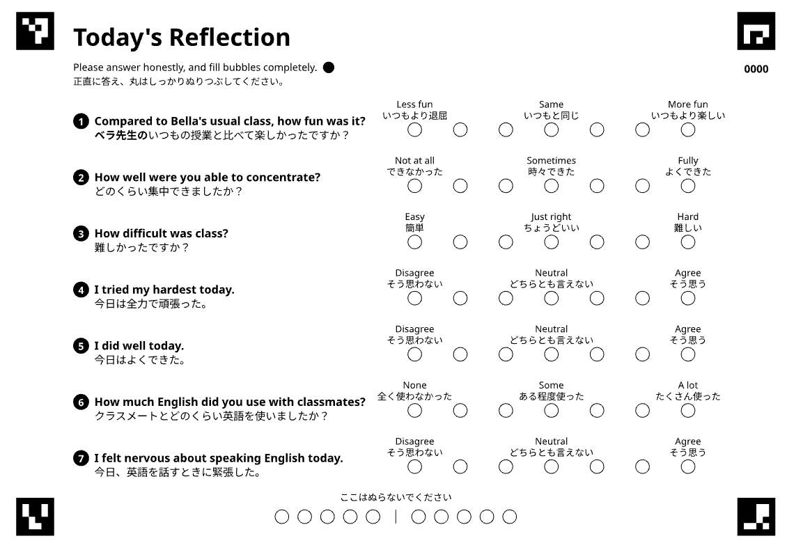
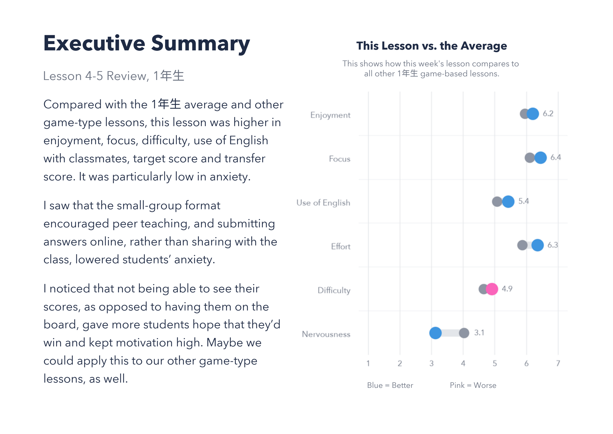

# Furikaeri Scanner

Reads bubble answers from scanned ふりかえり (furikaeri, reflection) worksheets and writes them to CSVs.

## Install

```bash
pip install -e .
```

Requires Python with OpenCV, PyMuPDF, NumPy, pandas, imutils, and PyYAML.

## Usage

From the project root, run:

```bash
scanner -f SCANS.pdf -s "SCHOOL_CODE" -c "CLASS_CODE" -l "LESSON_CODE" -o ./OUTPUT_FOLDER/
```

The file to scan, school code, class code, lesson code, and output folder are up to you to handle. Feel free to use `/worksheet/samples/sample.pdf`, which should return 5 scanned pages with no errors. 

| Flag | Description |
|---|---|
| `-f` | Scanned PDF (required) |
| `-s`, `--school` | School name |
| `-c`, `--class` | Class name |
| `-l`, `--lesson` | Lesson ID (`school + year + L + lesson_num`) |
| `-o`, `--output` | Output folder (default `./output/`) |

## Output

`results.csv` is a CSV with one row per PDF page, aka furikaeri scan. 

| Column | Meaning |
|---|---|
| `path` | Page name (`p01`, `p02`, …) |
| `school`, `class`, `lesson_id` | From command line flags |
| `error` | `True` if the page needs manual review |
| `q1`-`q7` | Selected bubble (0-6) |
| `target`, `transfer` | Selected bubble (0-4)|

A page is flagged `error` if alignment fails, the bubble count for any field is wrong, or a question has 0 or 2+ marks.

## Furikaeri

Print from `furikaeri/`. The four ArUco corner markers (`DICT_4X4_50`, IDs 0-3) must be visible in every scan.



You can import this into Canva to make your own version of the template with your own questions, but note that this will require extensive changes to the `config/config.yaml` file. 

If the position or size of the AruCo markers changes, it is possible that the scans will fail. 

## Example Report

Here is an example of an executive summary on a weekly lesson generated using the data from this project. 


